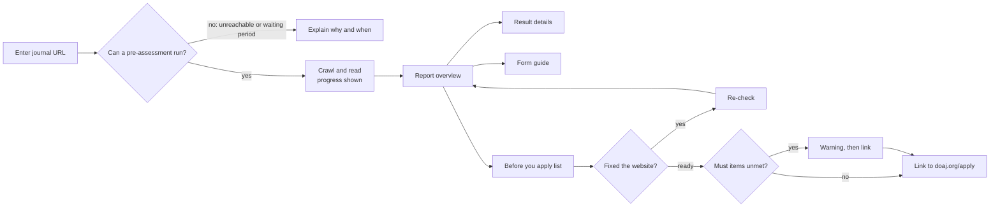
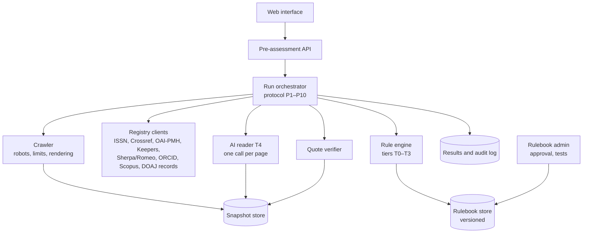

# Product Requirements Document: AI-Assisted DOAJ Pre-Assessment

**Author:** Ikhwan Arief (ikhwan[at]doaj.org) · **Date:** 1 October 2026
**Built from:** *User Requirements Document: AI-Assisted DOAJ Pre-Assessment* (the URD) and *DOAJ Pre-Assessment Rulebook and Knowledge Base* (the rulebook)
**Audience:** DOAJ product owner, developer team, design, and editorial policy team

> This PRD is a stakeholder proposal, not an official DOAJ document. It turns the URD (what users need) and the rulebook (what the system knows and how it assesses) into a product plan: scope, features, releases and success measures. Requirement ids such as `FG-02` refer to the URD; rule ids such as `ED-05` refer to the rulebook. Values DOAJ still has to set are listed in [section 12](#12-values-doaj-must-set-before-build), never invented.

---

## Contents

1. [Summary](#1-summary)
2. [Problem](#2-problem)
3. [Goals and non-goals](#3-goals-and-non-goals)
4. [Success metrics](#4-success-metrics)
5. [Users](#5-users)
6. [User stories](#6-user-stories)
7. [Release scope](#7-release-scope)
8. [Features](#8-features)
9. [User experience](#9-user-experience)
10. [Content and tone](#10-content-and-tone)
11. [Technical considerations](#11-technical-considerations)
12. [Values DOAJ must set before build](#12-values-doaj-must-set-before-build)
13. [Risks](#13-risks)
14. [Launch plan](#14-launch-plan)
15. [Traceability](#15-traceability)

---

## 1. Summary

**Problem.** Many DOAJ applications are submitted before the journal is ready or with answers that do not match its website. Editors often do not understand what DOAJ's questions mean or what must be in place first. They learn it from a rejection, and DOAJ editors spend time on applications that were never ready.

**Product.** A pre-assessment that an editor runs **before** applying. The editor enters only the journal's homepage address. The system reads the website and public registries, checks them against the DOAJ application form and criteria, and returns:

- a **pre-assessment report**: what already meets DOAJ's requirements and a suggested correction for each gap, pointing to the correct reference wording;
- a **form guide**: for every question of the official application form, the answer the website supports, the link to give, what DOAJ means, and common mistakes.

The editor fixes the website, re-checks, and then fills in the official form at doaj.org/apply, understanding each answer. The product never fills in or submits the application and never predicts DOAJ's decision.

**Outcome.** Fewer improperly executed applications, and editors who understand DOAJ's requirements before they apply.

---

## 2. Problem

An **improperly executed application** is one that is submitted:

| Type | Example | Rulebook rules that catch it |
|---|---|---|
| Too early | Less than one year of publishing and fewer than 10 OA research articles | JN-03, JN-04 |
| With information missing from the website | No statement on author charges; no licence terms | WS-01, FE-01, LC-01 |
| With answers that contradict the website | Form says CC BY; article PDFs say "All rights reserved" | LC-02, LC-04, FQ-08 |
| With links to the wrong pages | Homepage given where the peer review policy is asked | FQ-13, FQ-11 |
| With answer options that do not fit the journal | Editorial review chosen by a journal outside the arts and humanities | ED-04, FQ-11 |
| After a recent licence or copyright change that is not clearly documented | Articles moved from "All rights reserved" to CC BY a few months ago; the change appears only in a news item | LC-05, FQ-02 |
| With publisher details that do not match the ISSN record | ISSN registered in another country than the publisher's address | JN-09, JN-07 |
| With articles outside the journal's scope | Recent issues contain papers unrelated to the aims and scope | IN-01 |

The root cause is lack of understanding rather than bad faith. The form asks questions but does not explain them or check them against the website.

> **Note for the team:** DOAJ holds the data to size this problem (rejection reasons by category). Baselines for section 4 should come from that data before launch.

---

## 3. Goals and non-goals

### Goals

| # | Goal | Why it matters |
|---|---|---|
| G1 | Reduce improperly executed applications | Saves editors a failed attempt and a six-month wait; saves DOAJ reviewer time |
| G2 | Editors understand what DOAJ requires and why | Answers become correct because they are understood, not copied |
| G3 | Results are trustworthy | Every result is backed by a quote and link; judgement stays with DOAJ |
| G4 | Runs are fast and affordable | Cheapest-tier-first evaluation; AI only where rules cannot decide |

### Non-goals

- Filling in or submitting the official DOAJ application (URD HO-01).
- Predicting or influencing DOAJ's acceptance decision (URD RP-07, NF-07).
- Drafting journal policies; the product points to reference wordings only (URD RP-03).
- Judging scholarly quality, board expertise or whether a name is misleading (rulebook HJ-01…HJ-03).
- Replacing DOAJ's review in any way.

---

## 4. Success metrics

Targets are set by DOAJ once baselines are measured (section 12).

| Metric | Type | Definition | Source | Goal |
|---|---|---|---|---|
| Basic-information rejection rate | Outcome | Share of applications from pre-assessed journals rejected for missing or basic information, vs other applicants | DOAJ application records | G1 |
| Answer–website mismatch rate | Outcome | Mismatches found by DOAJ reviewers in applications from pre-assessed journals | Reviewer notes | G1 |
| Ready-before-apply rate | Outcome | Share of pre-assessed journals that apply only after all Must rules pass | Pre-assessment runs + application records | G1 |
| Editor understanding | Outcome | Survey score after the pre-assessment and after DOAJ's decision | Survey | G2 |
| Rule accuracy | Quality | Agreement between pre-assessment results and reviewer decisions, per rule | Labelled set; reviewer decisions (URD DJ-02) | G3 |
| Unverified-quote rate | Quality | Share of AI answers rejected by quote verification | Run logs | G3 |
| Run time and cost | Efficiency | Median time and compute cost per pre-assessment and per re-check | Run logs | G4 |
| AI calls per run | Efficiency | Number of T4 calls divided by pages with open rules (must be ≤ 1) | Run logs | G4 |
| Re-check usage | Engagement | Share of journals that re-check after fixing, and how many Must fails they close | Run logs | G1, G2 |

---

## 5. Users

| User | Situation | What they need | Priority |
|---|---|---|---|
| **First-time editor** | Runs a small journal (often on OJS, often not in English), preparing a first DOAJ application | To know if the journal is ready, what each form question means, and what to fix | Primary |
| **Returning editor** | Was rejected before and wants to fix the reasons before re-applying | To see exactly which criteria are still unmet and confirm fixes by re-checking | Primary |
| **Rulebook maintainer** | DOAJ editorial policy staff | To update rules, explanations and reference wordings each quarter without code releases | Secondary |
| **DOAJ reviewer** | Managing or associate editor | Later: to open a pre-assessment an applicant refers to; to help measure accuracy | Tertiary |

---

## 6. User stories

Each story lists the URD requirements it covers.

| # | As a… | I want to… | So that… | URD |
|---|---|---|---|---|
| US-01 | editor | start a pre-assessment by entering only my journal's URL | I don't have to fill in a long form to find out where I stand | ST-01 |
| US-02 | editor | be told at once if I cannot apply yet (waiting period, unreachable site, too little content) | I don't waste time | ST-02, JN-03 |
| US-03 | editor | see which DOAJ requirements my website already meets, with the evidence | I trust the result | RP-01, EV-06 |
| US-04 | editor | see what to fix, where, and the correct reference wording | I can correct my website myself | RP-01, RP-03 |
| US-05 | editor | read, for each official form question, the answer my website supports and the link to give | I fill in the real form correctly | FG-01, FG-02 |
| US-06 | editor | be warned when an answer I might give would contradict my website | I avoid a mismatch | FG-04 |
| US-07 | editor | understand what each requirement means and why DOAJ asks for it | I understand, not just copy | UN-01 |
| US-08 | editor | see clearly which items are required and which are recommended | I fix the right things first | UN-02, RP-02 |
| US-09 | editor | get a "before you apply" list grouped by web page | I can hand tasks to our webmaster | UN-03 |
| US-10 | editor | re-check after fixing, quickly | I can confirm the fixes | CR-07 |
| US-11 | editor | print or copy the form guide | I can keep it open while filling in the official form | FG-05 |
| US-12 | editor | be warned if Must items are unmet before I follow the link to apply | I decide knowingly | HO-02 |
| US-13 | editor | see which pages were read and report a misreading | I can make information findable, or flag an error | RP-04, RP-06 |
| US-14 | rulebook maintainer | change a rule or explanation without a code release, with approval | the product follows DOAJ's quarterly updates | RB-01, RB-03 |
| US-15 | DOAJ reviewer | open a pre-assessment an applicant refers to | I can see the evidence they saw | HO-03, DJ-01 |
| US-16 | editor | understand how a recent licence or copyright change affects my application, and what to state on my policy page | I document it correctly and apply at the right time | CR-09, EV-13, RP-08 |
| US-17 | editor | be warned when my ISSN is registered in a different country from my publisher's address | I correct or explain it before DOAJ asks | EV-14 |
| US-18 | editor | see which board members and reviewers lack a verifiable public profile, and the portfolios found | I can add profile links that help DOAJ confirm my board | EV-15 |
| US-19 | editor | see which recent articles look outside my aims and scope, and why | I can check my editorial screening and scope statement | EV-16 |

---

## 7. Release scope

Releases follow the URD priorities: **Must** requirements form the first release, **Should** the second, **Could** the third. No dates are set here; each release starts when the previous one passes its launch gate (section 14).

### Release 1 · Core pre-assessment (all URD Must requirements)

- Start with URL; validation and DOAJ-record check (ST-01, ST-02).
- Crawl with snapshots, sampling, PDF reading, polite crawling, robots.txt, incremental re-checks, announcement and history pages (CR-01…CR-03, CR-05…CR-09).
- Evaluation engine: protocol P1–P10, tiers, one AI call per page, quote verification, repeatability, endogeny, injection defence, multilingual reading, judgement rules left to DOAJ, record checks, licence and copyright change detection, ISSN-country comparison (EV-01…EV-14).
- Report with suggested corrections, reference wordings, severity order, pages read, readiness wording (RP-01…RP-04, RP-07).
- Form guide for every form v3.1 question (FG-01…FG-05).
- Understanding layer: explanations, level labels, "before you apply" summary (UN-01…UN-03).
- Handover: link to doaj.org/apply with Must warning (HO-01, HO-02).
- Rulebook store, versioning, approval, testing (RB-01…RB-04).
- Security, privacy, audit, AI governance, performance targets, accessibility, transparency, resilience, retention (NF-01…NF-09).

**Rulebook content in Release 1:**
- all form-question rules FQ-01…FQ-20;
- all `must`, `basic` and `warning_only` compliance rules, including LC-05 (licence and copyright changes) and JN-09 (ISSN country);
- human-judgement rules HJ-01…HJ-03, as evidence collection only;
- all conditional modules, because their rules are `must`;
- `should` and `best_practice` rules (ED-02, ED-06, ED-09, BP-01…BP-04). These mostly reuse FQ outputs at T1, so they add little cost, and UN-02 needs every level to be visible.

### Release 2 · Reach and polish (URD Should requirements)

- Crawl progress display (ST-03).
- JavaScript rendering for script-built sites (CR-04).
- Platform hints, e.g. where a policy goes in OJS (RP-05).
- Misreading reports routed to rulebook maintainers (RP-06).
- Explanations of why conditional modules apply (UN-04).
- Interface and explanations in several languages (UN-05).
- Reviewer decisions feeding accuracy tracking (DJ-02).
- Per-journal run limit (NF-10).
- Portfolio lookup for editors and reviewers (EV-15, rule ED-10).
- Scope check of the latest two issues (EV-16, rule IN-01).
- Timeline of licence and copyright changes in the report (RP-08).
- **Rulebook content:** the Principles checks PR-01…PR-20, ED-10 and IN-01.

### Release 3 · Connection to applications (URD Could requirements)

- Editors can give a pre-assessment reference in their application (HO-03).
- DOAJ reviewers can open referenced pre-assessments (DJ-01).
- Internet Archive captures to confirm the dates of policy changes (CR-10).

> **Note for the team:** CR-04 (JavaScript rendering) sits in Release 2 by URD priority, but script-built journal sites will return `unverifiable` results in Release 1. Measure how often this happens in the pilot; if it is common, pull CR-04 into Release 1.

---

## 8. Features

Each feature lists its purpose, behaviour, the URD requirements and rulebook sections it implements, and its acceptance criteria.

### F1 · Start and validation

- **Purpose:** one input, and an early stop when applying is not yet possible.
- **Behaviour:**
  - URL field only.
  - Check that the site is reachable.
  - Look up DOAJ records for rejections and exclusions, using the rulebook's waiting-period rules.
  - Show an early warning if the journal is too new (JN-03).
- **Implements:** URD ST-01, ST-02 · rulebook §2.1 P1, §3.8.
- **Acceptance:**
  - No other input is needed to start.
  - An unreachable site or active waiting period is explained before any crawl, with the date a new application is possible.

### F2 · Crawler and snapshots

- **Purpose:** collect all evidence in one polite pass.
- **Behaviour:**
  - Discover pages through navigation, sitemaps and platform paths.
  - Classify pages.
  - Sample the latest two issues, or the last calendar year for continuous publication.
  - Fetch article HTML and PDF, and all language versions.
  - Respect robots.txt and crawl limits.
  - Store each page as a snapshot with its fingerprint.
  - Read announcement, news and history pages, and older articles when a licence or copyright change is suspected.
  - Release 3: confirm change dates from Internet Archive captures.
- **Implements:** URD CR-01…CR-10 · rulebook §4, §3.9.
- **Acceptance:**
  - On a test set of compliant journals, every page required by WS-01 is found.
  - Blocked pages are never fetched.
  - An unchanged site re-checks with no page re-reads and no AI calls.

### F3 · Evaluation engine

- **Purpose:** decide every rule as cheaply and as correctly as possible.
- **Behaviour:**
  - Protocol P1–P10.
  - Each rule stops at its cheapest decisive tier.
  - AI work is collected into one call per page.
  - Every quote is verified.
  - Results are repeatable for the same snapshot, rulebook and model.
  - Licence and copyright changes are classified and handled by the decision guide (URD 8.4, rulebook §3.12, LC-05).
  - The publisher country is compared with the ISSN record (JN-09).
  - Release 2: portfolios of editors and reviewers (ED-10) and the scope check of recent issues (IN-01), each within its own cost budget.
- **Implements:** URD EV-01…EV-16 · rulebook §2, §3.12.
- **Acceptance:**
  - The logs show the deciding tier for every rule.
  - The AI call count never exceeds the number of pages with open rules.
  - A fabricated quote is never shown as Pass.
  - An injected instruction changes no result.
  - Identical input gives identical output.

### F4 · Rulebook store and administration

- **Purpose:** keep the product in step with DOAJ's quarterly criteria updates.
- **Behaviour:**
  - Load the rulebook's YAML into a versioned store.
  - Changes need editorial approval.
  - Each release is tested against labelled fixtures.
  - Every run is stamped with `rulebook_version`.
- **Implements:** URD RB-01…RB-04 · rulebook §0.1, §1, §9.
- **Acceptance:**
  - A rule or explanation changes without a code release.
  - Unapproved changes cannot reach production.
  - A release is blocked if accuracy falls below target.

### F5 · Pre-assessment report

- **Purpose:** show where the journal stands and what to fix.
- **Behaviour:**
  - Results are ordered by severity and grouped by the web page to change.
  - Each result shows its status, level label, evidence (quote, link, snapshot time), explanation, suggested correction and reference wording.
  - A list of pages read.
  - The disclaimer.
  - Release 2: a timeline of licence and copyright changes with the evidence for each date.
- **Implements:** URD RP-01…RP-08 · rulebook §0.4, §0.5, §8.1, §8.4.
- **Acceptance:**
  - Every non-Pass result has a suggestion from its template.
  - No generated policy text appears.
  - No wording predicts acceptance.

### F6 · Form guide

- **Purpose:** help the editor fill in the official form correctly and knowingly.
- **Behaviour:**
  - One entry per form v3.1 question, in form order.
  - Each entry has the supported answer (or "not found on your website"), the link to give, what DOAJ means, the criterion and level, common mistakes, and readiness.
  - Warnings where a likely answer contradicts the website.
  - Print and copy.
- **Implements:** URD FG-01…FG-05 · rulebook §5 (FQ-01…FQ-18), §8.2.
- **Acceptance:**
  - Every form question has an entry.
  - No entry suggests an answer without evidence.
  - Every contradiction rule produces a warning in the related entry.

### F7 · Understanding layer

- **Purpose:** make sure the editor understands, not just copies.
- **Behaviour:**
  - Plain-language explanation and the reason behind every requirement, with a link to the relevant section of the Guide to applying.
  - Level labels (Required / Recommended / Best practice / Principle).
  - "Before you apply" summary grouped by web page.
  - From Release 2: explanations of conditional modules, and multiple languages.
- **Implements:** URD UN-01…UN-05 · rulebook `explanation` fields, §0.2, §8.3.
- **Acceptance:**
  - Every rule shown has an explanation and a link.
  - The summary lists every open Must action.
  - Usability sessions show editors can explain each Must requirement (section 14).

### F8 · Handover to the official application

- **Purpose:** connect preparation to the real application without replacing it.
- **Behaviour:**
  - A link to doaj.org/apply.
  - A warning listing unmet Must rules before the link is followed; going on to apply is still allowed.
  - Release 3: an optional pre-assessment reference the editor can include in the application.
- **Implements:** URD HO-01…HO-03.
- **Acceptance:**
  - No path in the product submits data to the DOAJ application.
  - The warning appears whenever Must rules are unmet.

### F9 · Re-check

- **Purpose:** let the editor confirm fixes quickly.
- **Behaviour:** re-run with fingerprint comparison; only rules that depend on changed pages re-run. Results show what changed since the last run.
- **Implements:** URD CR-07 · rulebook §2.5.
- **Acceptance:** re-check time and cost are measured against their own target (section 12).

### F10 · DOAJ view (Release 2–3)

- **Purpose:** measure accuracy, and later let reviewers see referenced pre-assessments.
- **Implements:** URD DJ-01, DJ-02.
- **Acceptance:** accuracy per rule can be reported for any period; a referenced pre-assessment opens with its snapshots.

### F11 · Operations, security and data

- **Purpose:** run safely and within budget.
- **Behaviour:**
  - Public-URL-only fetching with private-address blocking.
  - Privacy-limited processing of names and identifiers.
  - Full audit log.
  - Fixed model and prompt versions per rulebook release.
  - Performance and cost dashboards.
  - WCAG 2.2 AA.
  - AI labelling.
  - Resilience when AI is unavailable (T0–T3 results still shown).
  - Retention: one month, or until the decision and appeal period end for referenced pre-assessments.
  - Run limit (Release 2).
- **Implements:** URD NF-01…NF-10.
- **Acceptance:** as stated in each NF requirement.

---

## 9. User experience

### 9.1 Main flow

### 9.2 Screens

| Screen | Purpose | Key content | Features |
|---|---|---|---|
| Start | Begin a pre-assessment | URL field; one-line explanation of what will happen; disclaimer | F1 |
| Progress | Show the run is working | Stage (crawl, registries, evaluation), pages read (Release 2: live) | F2 |
| Report overview | Where the journal stands | Counts of Required met / not met, Recommended, For DOAJ review; results grouped by web page; early-stop banner (e.g. too new) | F5 |
| Result detail | One criterion in depth | Status, level label, explanation and why, quote with link and snapshot time, suggested correction, reference wording, related form question | F5, F7 |
| Form guide | Prepare the official answers | One card per form question in form order; supported answer; link to give; meaning; common mistakes; warnings; print and copy | F6 |
| Before you apply | Action list | Tasks grouped by web page, Required first; re-check button | F7, F9 |
| Handover | Go to the official form | Warning listing unmet Must items (if any); link to doaj.org/apply | F8 |
| Pages read | Transparency | Every page fetched, its class, and any that could not be read and why | F5 |

### 9.3 Design principles

- **Evidence first:** every claim shows its quote and link one click away.
- **Required before recommended:** visual weight follows severity order.
- **One page, one task:** group work by the web page the editor must change.
- **Explain, don't judge:** consultation-peer tone; no scores that look like acceptance odds.
- **Accessible:** WCAG 2.2 AA, works on mobile and in print.

> **Note for design:** avoid a single overall "readiness percentage". It invites being read as an acceptance probability (URD RP-07). Show counts by level instead.

---

## 10. Content and tone

| Do | Don't |
|---|---|
| "Your website does not yet state author charges. DOAJ requires this even when there are no charges." | "You will be rejected." |
| "Suggested correction: add a statement on author charges. Reference: DOAJ Guide to applying, Journal website." | Write the policy text for the editor. |
| "Assessed by DOAJ editors. Evidence collected: …" | Give an opinion on board expertise. |
| "Ready" / "Not yet met" / "Please check" | "Pass/Fail" as the only wording shown to editors. |
| Quote the website in its own language, with a translation | Paraphrase the website. |

All advice text comes from the rulebook templates (rulebook §8); the AI never writes advice freely.

---

## 11. Technical considerations

These are proposals; architecture choices belong to the developer team.

### 11.1 Components

### 11.2 Core entities

| Entity | Key fields |
|---|---|
| Journal | homepage URL, ISSNs, platform, languages |
| Run | journal, start/end time, rulebook_version, model id, prompt version, status |
| Page snapshot | run, URL, fetch time, HTTP status, content type, text, fingerprint, page classes, language |
| Registry record | source, identifier, payload, fetched at |
| Person | name, role, affiliation, identifiers, source quote |
| Rule result | run, rule id, status, level, deciding tier, confidence |
| Evidence | rule result, quote, translation, URL, snapshot, verified flag |
| Misreading report | run, rule id, editor note (Release 2) |

### 11.3 Key technical notes

- **Cost control:** P6 and P7 stop before T4; P8 batches all AI questions per page (rulebook §2.1). This is the main cost lever.
- **Repeatability:** temperature 0, fixed model per rulebook release, caching by page fingerprint.
- **Safety:** crawled text is untrusted data; AI output is verified; there is no path to submit to DOAJ's application.
- **Reuse:** the Journals Toolkit already contains a Cloudflare Worker URL reader with private-address blocking and size caps, and an OAI-PMH validator. They may serve as references for the crawler and registry clients.

---

## 12. Values DOAJ must set before build

The rulebook leaves these as `TBD by DOAJ`. They are needed before Release 1 can pass its gate.

| Value | Used by | Rulebook reference |
|---|---|---|
| Crawl limits: pages, bytes per page, run time, request rate | F2 | §4.3 |
| Runs per journal per day | F11 (Release 2) | §4.3, URD NF-10 |
| Click depth that counts as "easily accessible from the homepage" | WS-01 | §6.3 |
| AI model id and confidence threshold | F3 | §2.3 |
| Minimum quote length for verification | F3 | §2.4 |
| Minimum dated articles for the weeks-to-publication estimate | FQ-14 | §5 |
| Accuracy target per rule (release gate) | F4 | §9, URD RB-04 |
| Performance and cost targets per run and re-check | F9, F11 | URD NF-05 |
| Access terms for the ISSN Portal, Keepers Registry, Sherpa/Romeo and Scopus | F2 | §3.7 |
| National accreditation lists accepted as metrics | WS-02 | §3.5 |
| Whether pre-assessments may run during a publisher ban | F1 | §3.8 |
| Confirmation that the one-year / ten-article rule applies to a change from non-open to open licensing | F3 | §3.12, LC-05 |
| Confidence needed to accept a profile search match | F3 (Release 2) | ED-10 |
| Similarity threshold for the scope pre-filter, and the out-of-scope share that triggers DOAJ review | F3 (Release 2) | IN-01 |
| Baselines and targets for the success metrics | Section 4 | — |

---

## 13. Risks

| Risk | Mitigation in this product |
|---|---|
| Editors copy the form guide without understanding it | F7 explanations with reasons; no answer without evidence; action summary; usability testing |
| A good result is read as a guarantee | No overall score; disclaimer; judgement rules left to DOAJ |
| The crawler cannot reach information that exists | PDF reading (Release 1), JavaScript rendering (Release 2), pages-read list, misreading reports |
| AI reports Pass without real evidence | Quote verification; accuracy tracking per rule |
| Journals add text to satisfy rules without following the practice | Article-level checks (LC-02, LC-04, ED-05, ED-06); DOAJ still reviews every application |
| Common names distort endogeny | Name plus affiliation matching, identifiers, uncertain matches shown separately (ED-05) |
| Profile search matches the wrong person | Name and affiliation must both match; confident matches only; sources shown (ED-10) |
| Scope check flags articles in interdisciplinary journals | Warning, never Fail; quoted reason; "borderline" allowed; threshold set by DOAJ (IN-01) |
| A licence or copyright change is announced only in a news item | Announcements are read (CR-09) but LC-05 asks for the dated change on the policy page |
| Lower accuracy on non-English sites | Original-language reading; per-language evaluation; lexicon extended per language |
| Prompt injection through crawled pages | Pages treated as data; injection reports; red-team tests |
| Load on small journal servers | Polite crawling, robots.txt, incremental re-checks, run limit |

---

## 14. Launch plan

| Stage | What happens | Gate to the next stage |
|---|---|---|
| Labelled set | Build fixtures from journals DOAJ has already decided: indexed, rejected for basic information, rejected for integrity reasons, non-English, hard to crawl | Fixtures cover every Release 1 rule (rulebook §9) |
| Internal alpha | Run Release 1 on the labelled set; DOAJ staff compare results with decisions | Accuracy per rule meets the target; AI-disabled run completes; red-team tests pass |
| Pilot | Invite a small group of editors preparing first applications; usability sessions | Editors can explain each Must requirement and fill in the form without mistakes; unverifiable rate is acceptable (decide on CR-04) |
| Open beta | Public access with the disclaimer; measure the section 4 metrics | Basic-information rejection and mismatch rates improve against baseline |
| General availability | Release 1 complete; start Release 2 | Release 2 scope confirmed from pilot and beta findings |

---

## 15. Traceability

Every URD requirement maps to a feature and a release.

| URD requirements | Priority | Feature | Release |
|---|---|---|---|
| ST-01, ST-02 | Must | F1 | 1 |
| ST-03 | Should | F2 | 2 |
| CR-01, CR-02, CR-03, CR-05, CR-06, CR-07, CR-08, CR-09 | Must | F2, F9 | 1 |
| CR-04 | Should | F2 | 2 |
| CR-10 | Could | F2 | 3 |
| EV-01 … EV-14 | Must | F3 | 1 |
| EV-15, EV-16 | Should | F3 | 2 |
| RP-01, RP-02, RP-03, RP-04, RP-07 | Must | F5 | 1 |
| RP-05, RP-06, RP-08 | Should | F5 | 2 |
| FG-01 … FG-05 | Must | F6 | 1 |
| UN-01, UN-02, UN-03 | Must | F7 | 1 |
| UN-04, UN-05 | Should | F7 | 2 |
| HO-01, HO-02 | Must | F8 | 1 |
| HO-03 | Could | F8 | 3 |
| DJ-01 | Could | F10 | 3 |
| DJ-02 | Should | F10 | 2 |
| RB-01 … RB-04 | Must | F4 | 1 |
| NF-01 … NF-09 | Must | F11 | 1 |
| NF-10 | Should | F11 | 2 |

| Rulebook content | Feature | Release |
|---|---|---|
| §2 Protocol, §2.3 AI contract, §2.4 verification, §2.5 re-check | F3, F9 | 1 |
| §3 Knowledge base, §4 crawl and sampling | F2, F3 | 1 |
| §5 FQ-01 … FQ-20 | F6 (and inputs to F3) | 1 |
| §6 JN, OA, WS, LC, ED, FE, BP rules; HJ-01 … HJ-03 | F3, F5 | 1 |
| §6.8 PR-01 … PR-20 | F3, F5 | 2 |
| §3.12 change classification; LC-05; JN-09 | F3, F5 | 1 |
| ED-10; §6.10 IN-01 | F3, F5 | 2 |
| §7 Conditional modules | F3, F5 (explanations F7 in Release 2) | 1 |
| §8 Templates and disclaimer | F5, F6, F7 | 1 |
| §9 Testing | F4, launch plan | 1 |
